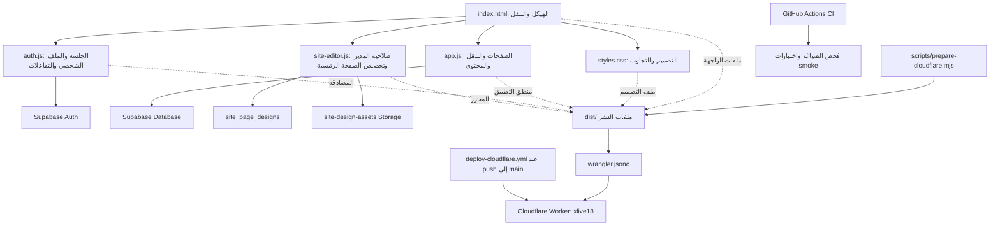

# خريطة مشروع XLIVE18

هذه الخريطة تحدد أين يوجد كل جزء من الموقع، وأين يجب إجراء التعديلات حتى تصل إلى النسخة المنشورة.

## خريطة تدفق الموقع

## أين يتم تعديل كل شيء؟

| الجزء | الملف/المكان | مسؤوليته |
|---|---|---|
| بنية الصفحة والأزرار والتنقل | `index.html` | الشريط الجانبي، شريط الهاتف، الرأس، تحميل ملفات JavaScript |
| الألوان والتخطيط وحل مشاكل عرض سطح المكتب على الهاتف | `styles.css` | RTL، نقاط التحول، عرض المحتوى، overflow، شبكة التنقل |
| التنقل وعرض الأقسام | `app.js` | الصفحة الرئيسية، المقاطع، الغرف، الرسائل، والتحويل بين المشاهد |
| تسجيل الدخول والجلسة والملف الشخصي | `auth.js` | Supabase Auth، الحسابات، الرسائل والتفاعلات |
| زر «تعديل الموقع» وحفظ التصميم | `site-editor.js` | إظهار المحرر للمدير، المعاينة، حفظ عنوان الصفحة ونصها ولونها والصور |
| إعداد الاتصال العام بـ Supabase | `supabase-config.js` | رابط المشروع والمفتاح العام فقط؛ لا يوضع مفتاح service-role هنا |
| إعدادات الجداول والصلاحيات والتخزين | `supabase/migrations/` | مخطط قاعدة البيانات وRLS وسياسات Storage |
| تجهيز ملفات Cloudflare | `scripts/prepare-cloudflare.mjs` | نسخ الملفات المطلوبة إلى `dist/` |
| إعداد نشر Worker | `wrangler.jsonc` | اسم Worker ومجلد الملفات الثابتة |
| الفحص الآلي | `.github/workflows/ci.yml`, `tests/smoke.test.js` | فحص JavaScript واختبارات بنيوية |
| النشر الآلي | `.github/workflows/deploy-cloudflare.yml` | يبني `dist/` وينشر Worker عند الدفع إلى `main`؛ يحتاج سر GitHub باسم `CLOUDFLARE_API_TOKEN` |

## العطل الذي تم العثور عليه

كانت صفحة `index.html` تحمّل `site-editor.js`، لكن قائمة الملفات التي ينشئها `scripts/prepare-cloudflare.mjs` لم تكن تنسخه إلى `dist/`. لذلك كان ممكنًا أن تُحدّث الملفات في GitHub بينما تظل نسخة Cloudflare بلا الكود الذي يفحص صلاحية المدير ويُظهر زر المحرر.

تم تعديل سكربت البناء ليشمل `site-editor.js`، وإضافة اختبار يمنع حذف أي ملف JavaScript تستدعيه الصفحة من قائمة البناء.

## حالة Supabase

تم فحص المشروع المرتبط مباشرةً: جدول `public.site_page_designs` موجود مع RLS، ومخزن `site-design-assets` موجود كحاوية عامة للصور بحد 8 ميغابايت، مع سياسات قراءة عامة وكتابة للمشرفين. لا توجد حاليًا صفوف تصميم منشورة في الجدول، وهذا طبيعي قبل أول حفظ ناجح.

أُضيف ملف ترحيل إلى المستودع لتوثيق مخطط المحرر وصلاحياته. لا حاجة لإعادة إنشاء المشروع أو إعادة إعداد الحساب.

## النشر: النقطة التي يجب عدم تجاوزها

أُضيف ملف `.github/workflows/deploy-cloudflare.yml` لينفذ البناء والنشر تلقائيًا عند الدفع إلى `main`. يحتاج إلى GitHub Actions secret باسم `CLOUDFLARE_API_TOKEN` بصلاحية تعديل Workers؛ معرّف الحساب موجود في إعدادات سير العمل. إذا لم يكن السر مضبوطًا، سيُظهر سير العمل خطأ صريحًا ولن ينشر.

لا أعتبر الإصلاح منشورًا حتى ينجح سير النشر ويُتحقق من النسخة الحية. بعد نجاحه، يجب طلب الملف `/site-editor.js` من النطاق المنشور، ثم فحص جلسة المدير وصلاحية `app_metadata.role` إذا ظل الزر مخفيًا.
